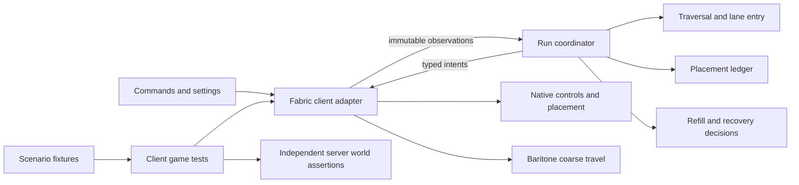

# MapArtRunner v2 design

Status: proposed design for review. Planning only; implementation has not started.

## Intent and chosen approach

Build a separate v2 that operates cleanly and reliably, preserves working behavior, and can be changed without causing unrelated failures. The owner explicitly chose **a separate v2 implementation with the current version kept as a reference** on 28 October 2026. Repeatable testing supports that outcome. Minecraft 1.12.2 remains a later target.

The reference is commit `51ad8a53a578901e5bb83db082e98f8104abbf58`. Its existing 419 JUnit tests passed with no failures, errors, or skips during the assessment. Six failure paths were found in source; their live reproductions have not been executed. See the [baseline assessment](../../assessments/2026-10-28-reliability-baseline.md).

Approaches considered:

| Approach | Benefit | Tradeoff | Decision |
|---|---|---|---|
| Repair and restructure v1 in place | Smaller initial changes; working build at each step | New structure remains entangled with existing lifecycle state during migration | Not selected |
| Separate v2 with behavioral checkpoints | Clean ownership and testable boundaries; v1 remains usable | More work before feature parity; requires an explicit parity checklist | Selected by owner |
| Port first and redesign there | Directly reaches the eventual game version | Changes platform and behavior together before a reliable baseline exists | Deferred |

Use the same Git repository, with an independently built `v2/` project. This location is the planner's choice: it preserves one history and lets both implementations be compared without mixing their runtime classpaths. Do not create another GitHub repository as part of this plan.

## Goals and limits

Required outcomes:

- Correct flat mapart from supported schematics, with native five-wide serpentine movement and placement.
- Reliable approach, refill, pause/resume, recovery, reverse cleanup, and stop behavior.
- Explicit ownership of state and controls, with small, typed contracts between responsibilities.
- Repeatable local setup/reset/run/inspection without rebuilding the test world or pasting setup commands each time.
- Tests against production decisions and real client/server behavior, with useful preserved failure evidence.
- A clear boundary around game-version-specific code so later port work is contained.

The initial platform remains Minecraft **1.21.11**, Java **21**, Fabric Loader **0.19.2**, Fabric API **0.141.1+1.21.11**, Yarn **1.21.11+build.4**, Loom **1.16.1**, Gradle **9.5.0**, and JUnit Jupiter **5.10.2**. These are the existing build's pins; review any change separately.

Do not modify v1 production code, its build, settings, or test expectations to make v2 work. Do not copy the large grounded runner wholesale. Reuse understood algorithms, test cases, and lessons from v1. Fix known defects instead of treating their output as required compatibility.

New flight/staircasing functionality and the executable 1.12.2 port are outside this version's initial scope. Existing working helper features, settings, command aliases, keybindings, overlays, and utilities must be inventoried; the default is to retain them before replacing v1. Any intentional omission requires an explicit owner decision. Experimental Elytra code remains a reference, consistent with the current grounded-first scope.

## Project structure

```text
v2/
  settings.gradle                 independent build; includes core and fabric
  build.gradle                    shared Java/test conventions
  gradle.properties               explicit platform pins
  core/                           Java library; no Minecraft/Fabric/Baritone types
  fabric/                         client mod, game integration, client game tests
  test-fixtures/                  scenario descriptions and schematic resources
  docs/                           parity matrix and developer testing guide
scripts/
  test-v2.ps1                     Windows entry point for automated or inspect mode
```

Reuse the repository's Gradle wrapper with `gradlew.bat -p v2 ...`; do not add a second independently drifting wrapper. V1 continues to build at the repository root. V2 uses packages `com.mapartrunner.core` and `com.mapartrunner.fabric`, artifact name `mapartrunner-v2`, and the existing public `/mapart` namespace and `mapart` mod ID. V1 and v2 must run in separate game directories and must never be loaded together. Put development/game-test directories under `v2/fabric/build/run/` and retained automated artifacts under `v2/fabric/build/scenario-results/`, which are already covered by the repository's `build/` ignore rule.

## Responsibilities and allowed dependencies



The diagram's core boxes live in `core`; game actions live in `fabric`. Dependencies flow from Fabric to core. Core never loads a Minecraft singleton, sends a packet, opens a screen, reads a game directory, or changes keys. Keep this as two production modules; do not create a general plugin framework or event bus.

| Owner | Owns | Must not own |
|---|---|---|
| Run coordinator/lifecycle | Run identity, world binding, phase, pause/stop, scheduling, terminal result | Detailed lane geometry, slot clicking, independent copies of target truth |
| Traversal | Lane geometry, entry position, forward/reverse schedule, resume selection | Player key application, refilling inventory, deleting unfinished targets |
| Placement ledger | Immutable expected targets, observations, pending attempts, retries/audits, unfinished set | Movement policy or chest navigation |
| Movement policy | Cardinal movement/yaw intent, lane entry, support holds | Direct key writes or Baritone calls |
| Refill flow | Target inventory totals, container-trip progress and bounded outcomes | Resetting traversal/placement state or controlling active lane movement |
| Recovery policy | Stabilization and bounded resume decisions | Rebuilding another component's internal state |
| Fabric adapter | World/inventory observations, effects, version conversions, control arbitration | Deciding that an unverified build is complete |
| Diagnostics | Run/target/action identifiers and state-transition evidence | Changing behavior when logging is enabled |

Each mutable field has one owner. Other components receive immutable snapshots or explicit results. The coordinator sequences work; components do not call each other to clear fields. A field's lifecycle specifies creation, pause retention, reset, terminal cleanup, and world-change behavior.

## Core contracts and invariants

Use ordinary Java values such as `GridPos(int x, int y, int z)`, `BlockSpec(String id, Map<String,String> properties)`, target IDs, item identifiers, and counts. These are version-neutral meanings, not a promise of Java 8 binary compatibility. Block/item resolution belongs to the Fabric adapter. Unsupported schematic content must produce a useful error, not a silent omission.

The neutral plan also carries source dimensions and a fingerprint derived from normalized content; target IDs are stable plan indices. The initial importer accepts the reference loader's supported flat schematic formats and produces the neutral plan. All-air/empty plans return a clear nothing-to-build result without starting movement. Keep schematic loading in the first real-build milestone rather than bypassing it with an in-memory fixture only.

Lifecycle phases are `IDLE`, `RUNNING`, `PAUSED`, and `TERMINAL`. While running, the coordinator has one activity: `APPROACH`, `BUILD`, `SHIFT`, `REFILL`, `RECOVER`, or `VERIFY`. Component-local stages remain inside their owner. Pausing retains resumable target/traversal data but releases effects; stopping/cancelling clears transient attempts, recovery and control ownership. A manual resume with a changed connection/world binding must start a fresh run after a world scan, not reuse the old live snapshot.

The following invariants are required throughout v2:

1. The immutable plan defines every required target. A pending queue is not the definition of what should exist.
2. Every target remains accounted for until confirmed, explicitly unresolved, or cancelled with the run. Starting near a later lane cannot lose earlier unfinished targets.
3. An accepted placement request is not a confirmed placement. Unknown/unloaded or prediction-only state cannot establish successful completion.
4. `SUCCESS` means all required targets passed final verification. Unresolved targets produce a partial or failed outcome with reasons; they cannot be hidden by a completed traversal.
5. A lane begins only after the required entry coordinates and yaw are satisfied, including when clean lanes were skipped.
6. Refill requests carry **target inventory totals**, named accordingly. `additionalNeeded = max(0, targetTotal - usableHeld)` is calculated once at the inventory boundary. Reserved slots are excluded consistently.
7. Every active wait has an explicit success, failure, and timeout/progress policy. A stalled client tick must not silently consume normal simulation-time budgets.
8. Exactly one control owner is active: none, native movement, or coarse travel. Switching ownership releases the previous controls first. Stop, panic, disconnect, and world replacement release controls and outstanding actions.
9. Runs and paused snapshots bind to a connection/world identity, dimension, plan fingerprint, origin, and settings snapshot. Rejoining never automatically resumes an old run. Manual resume performs fresh validation.
10. Results from old runs/actions cannot mutate a newer run. Correlate effects and confirmations with run and action IDs.

A single client tick gathers observations, advances the core once, and applies the resulting intents in a defined order. Do not add hidden extra engine ticks as a speed feature. Separate movement time, confirmation deadlines, and wall-clock diagnostics so timing behavior can be tested deterministically.

The adapter must distinguish available world observations from client prediction while placement is in flight. Verify that distinction with client/server tests before claiming placement confirmation works. For real gameplay the mod has only its client-side evidence; test assertions can inspect the server directly and must use that independent truth.

## Compatibility and parity

Create `v2/docs/behavior-parity.md` before implementation. For each feature, record the reference source/tests, expected behavior, scenario, and status. Preserve geometry, WEST/SOUTH strafe correction, yaw staging, delayed confirmation/audits, hotbar reservation, refill return/resume, leftovers, panic, and supported user commands. Record the six assessment defects as deliberate corrections.

Do not use exact input timing or every old internal trace as an oracle. Compare final blocks, retained progress, control ownership, bounded outcomes, and documented settings/commands. UI text or timing changes that affect users must be recorded. V1 remains available until v2 satisfies this matrix; no automatic installation or data migration is part of early milestones.

## Repeatable testing and debugging

Use three complementary layers:

- Core JUnit tests for deterministic decisions and state transitions. Port useful v1 cases and add the six defect reproductions. Tests must exercise production-used logic.
- Fabric client game tests for actual keys, physics, placement, screen/inventory interactions, and client/server confirmation.
- A development-only scenario session for reset, run, rerun, and inspect without relaunching for every attempt.

The first scenario is a small two-lane flat build with sufficient inventory. Each scenario describes its schematic, bounded setup region/apron, player start, inventory, chests, origin, settings, expected blocks, and a finite tick budget. The setup geometry can be settled by the builder after proving legal native entry; it must be checked into fixture data, not hidden in a tester's saved world.

Automated mode creates disposable worlds and archives results before cleanup. Inspect mode stays in a dedicated managed development world and provides `/maparttest reset <scenario>`, `run <scenario>`, `rerun <scenario>`, and `last`. These commands live only in the test fixture mod and are absent from the released JAR. Both modes share scenario setup and assertions through a test-only adapter. Reset stops the old run, archives evidence, restores the managed region, player/inventory/containers, plan/origin/settings and supplies, and checks its starting state before starting again. It must refuse unmanaged worlds and regions.

The Windows entry point is planned as `scripts/test-v2.ps1 -Scenario grounded-two-lane -Repeat 2`, with `-Inspect` for the persistent development session. These flags do not exist yet. Use local JDK discovery/process-level configuration; do not require a particular launcher product or permanently rewrite the user's environment.

Results include fixture hash, seed, game/mod/Baritone versions, settings, run ID, target mismatches, state transitions, timeout reason, logs, and failure screenshot. A stopped or incomplete scenario is a failure, never a successful skip. Two back-to-back baseline runs establish reset acceptance; broader repetition/soak budgets are measured and set before the release milestone.

Add variants for partial inventory refill, rejected return navigation, sparse earlier leftovers, selective reverse lanes, missing support, delayed confirmation, pause/resume, recovery, and world changes. Label simulated fault injection honestly. Real Baritone navigation is a separate required integration check, not replaced by a fake returning success.

## Architecture and change gates

Use test-only ArchUnit checks for the new modules: core has no game/loader/Baritone dependencies, Fabric depends on core, core packages have no dependency cycles, and game effect APIs remain in the adapter. Introduce checks when their first production package exists, so an empty scan cannot pass as evidence. Keep compile-time module separation as the first guard.

Every change identifies its intended behavior and affected contracts, adds a failing regression for new nontrivial behavior, preserves valid existing tests, and runs the relevant interaction scenarios. Do not weaken assertions or skip required scenarios to make a change pass. Separate behavior corrections from structural moves in reviewable commits/PRs. Run v1's suite when shared root infrastructure changes; no need to rebuild v1 after every isolated core edit.

No arbitrary coverage or mutation-score target is claimed today. Measure and hold a meaningful baseline when tooling is introduced; scenario correctness and dependency boundaries are required independently of coverage percentages.

## Later 1.12.2 port

Keep fixture descriptions, target accounting, traversal/refill/recovery policies, and outcome assertions independent of Fabric. A future game adapter will replace version-specific observation/effect code and test-world bindings. Schematics and block properties need an explicit mapping/unsupported-content policy.

Do not choose the 1.12.2 loader/runtime, downgrade the present Java code, or promise shared compiled binaries in this project phase. A conventional Forge 1.12.x target has Java 8 constraints; alternative targets require their own verification. The release gate for this phase is reliable 1.21.11 operation and a tested boundary, not an executable port.

## Delivery checkpoints

1. **Reference and guardrails:** parity matrix, module/build isolation, core model, and boundary checks.
2. **First real build:** one lane then two lanes, actual placement confirmation, independently verified world, and a resettable scenario.
3. **Complete grounded workflow:** resume/cleanup, genuine refill/return, recovery, world/stop lifecycle, and all six defect cases.
4. **Daily usability:** commands/settings/HUD and working helper parity, inspect workflow, preserved diagnostics.
5. **Replacement readiness:** dedicated-server runs, variation/soak results, documented supported environment, full parity review, and deliberate cutover choice.

Each checkpoint requires working software and its own evidence. V2 is not declared a replacement after the first successful demonstration.

## Risks and builder choices

- Exact-version Baritone distribution is not yet validated on this machine. First prove native building without it, then pin and verify a genuine compatible binary before refill acceptance. Missing Baritone must give a clear bounded outcome; it must not turn required tests into skips.
- Client game tests, graphics/headless execution, EULA prerequisites, and clean-machine setup still need an initial feasibility task. Do not silently accept terms or claim headless CI is ready before proving it.
- Java 21 language features remain allowed. Source/runtime conversion for a future legacy target is separate work.
- Builders may choose private helper names, fixture coordinates, and UI layout consistent with the contracts. Changing ownership boundaries, public behavior, or scope requires updating this design.

Primary references: [Fabric 1.21.11 automated testing](https://docs.fabricmc.net/1.21.11/develop/automatic-testing), [exact-version client test context](https://maven.fabricmc.net/docs/fabric-api-0.141.1%2B1.21.11/net/fabricmc/fabric/api/client/gametest/v1/context/ClientGameTestContext.html), [ArchUnit guide](https://www.archunit.org/userguide/html/000_Index.html), [Forge 1.12.x setup](https://docs.minecraftforge.net/en/1.12.x/gettingstarted/).
